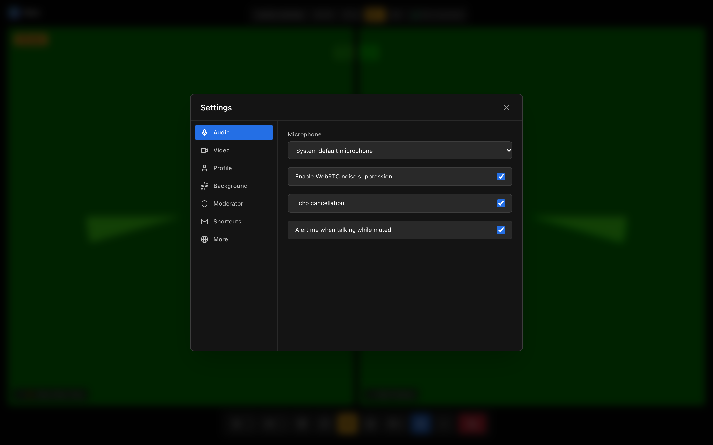

<p align="center">
  <picture>
    <source media="(prefers-color-scheme: dark)" srcset="web/public/brand-assets/logo_dark.svg">
    <source media="(prefers-color-scheme: light)" srcset="web/public/brand-assets/logo.svg">
    
  </picture>
</p>

<h3 align="center">The lightweight video conferencing stack — Rust (Axum + str0m SFU) + React Router PWA + UniFFI Swift/Kotlin rewrite of Jitsi Meet</h3>

<p align="center">
  
  
  
  
</p>

> **Note:** Nova is a ground-up Rust rewrite of [Jitsi Meet](https://github.com/jitsi/jitsi-meet). Prosody (Lua XMPP), Jicofo (Java), Jitsi Videobridge (Java SFU), and Nginx are replaced by one compiled Rust binary (**Axum 0.8** + **str0m 0.26** WebRTC SFU + embedded **SQLite**), paired with a **React Router 8 + Tailwind v4 PWA** (`web/`) aligned with Jitsi Meet's design tokens and UX, and thin native **SwiftUI (iOS)** + **Jetpack Compose (Android)** clients sharing protocol, state, and E2EE key derivation via **Rust UniFFI (`crates/nova-core`)**. Jitsi Meet is © 8x8 / Atlassian / Jitsi contributors, Apache-2.0 licensed (see [`LICENSE-JITSI`](LICENSE-JITSI)). Nova is not affiliated with Jitsi or 8x8.

---

### ⚡ Single binary, ~10–12 MiB RAM locally

No Prosody, no Java JVM (Jicofo/JVB), no Redis, and zero external database process required by default. The HTTP/WebSocket signaling server, multiplexed UDP WebRTC SFU, SQLite persistence, and static React Router PWA run out of one compiled executable (**11.55 MiB** release binary + **561.0 KiB** `web/build/client` bundle on macOS `arm64`, starting in **48 ms** at **10.67 MiB** idle / **11.91 MiB** post-load RSS).

### 🎥 Real `str0m` WebRTC SFU & Jitsi Meet UI / Feature Parity

- **Jitsi Meet Visual System (`#040404` / `#141414` / `#292929` / `#246FE5`):** Blue-gradient hero Welcome screen with integrated `"Start meeting"` bar + `"Recent"` / `"Active rooms"` tabs, Jitsi split-screen Prejoin (`Join without audio`, `Join audio-only`, device selectors, virtual backgrounds), full-bleed dark Conference stage with top `ConferenceInfo` (`MM:SS` timer + live `getStats()` Connection Stats popover), compact floating Toolbox w/ device chevrons & `...` Overflow Menu, left `Chat / Polls / CC / Files` drawer, right `Participants & Breakout Rooms` pane, bottom-left toast notifications, and post-call 5-star feedback persisted in SQLite.
- **Audio, Video & Captions:** Device hot-swapping, WebRTC noise suppression & echo cancellation toggles, local video mirror toggle, Video Quality presets (`HD` / `SD` / `Low` / `Audio-Only`), Canvas 2D virtual backgrounds (`Slight blur`, `Blur`, `Studio`, `Ocean`, `Warm loft`, `Minimal dark`), Web Speech API Closed Captions + `.txt` transcript export, Talk-While-Muted detection, Fullscreen, Picture-in-Picture, and local WebM recording.
- **Security & Moderation:** Argon2id (`Algorithm::Argon2id`) host accounts with HMAC-SHA256 `HttpOnly` sessions, Jitsi-compatible HS256 room JWT tokens, room password lock, knock lobby with quick-Admit toasts, HKDF + AES-256-GCM E2EE (`nova-core::e2ee` + WebRTC Encoded Transform for all peers), AV moderation (`start_audio_muted` / `start_video_muted`), Follow-Me layout sync, `Mute everyone`, and `End meeting for all`.
- **Collaboration & Shared Media:** Chat with replies, DMs & timestamps, room file sharing (`<= 5 MiB` stored in SQLite), live polls, shared YouTube/MP4 synced video player, raise hand, floating emoji reactions, SFU-isolated breakout rooms, collaborative whiteboard with PNG export, speaker stats, keyboard shortcuts (`?`, `M`, `V`, `C`, `P`, `R`, `T`, `S`, `W`, `F`, `Space`), and EN/ID localization.
- **Drop-in Jitsi Compatibility:** Serves `/external_api.js` (`JitsiMeetExternalAPI` / `NovaMeetExternalAPI`), `/config.js`, `/interface_config.js`, and `/embed/{room}` iframe bridge.
- **Intentional Scope Exclusions ([`ADR-006`](rust/DECISIONS.md)):** Legacy XMPP/BOSH wire protocol (`Prosody`), `Jigasi` SIP/PSTN dial-in, headless Chrome `Jibri` cloud recording/RTMP streaming, and third-party SaaS connectors (Dropbox, Salesforce, Amplitude, Google/Microsoft Calendar OAuth, Etherpad) are excluded by architecture in favor of browser/local WebM recording, native SQLite file sharing, and `/ws/{room}` signaling.

### 📱 Native Mobile via Rust UniFFI (Zero React Native / Flutter VM Bloat)

Rather than bundling React Native (`0.85` + Hermes + Metro) or Flutter (Dart VM + Skia), Nova compiles signaling JSON codecs, URL parsing, deterministic `RoomSnapshot` state reduction, and E2EE key derivation once in `crates/nova-core` (`uniffi 0.33`), generating native Swift (`mobile/ios/`) and Kotlin (`mobile/android/`) bindings consumed by thin SwiftUI and Jetpack Compose UIs (Welcome, Recent Meetings, Prejoin, Audio-Only, Car Mode, Tile/Filmstrip Stage, Chat/DM & Polls, Participants/Lobby/Moderation, Breakout Rooms, Security/E2EE, Speaker Stats, Settings). Note: iOS `swift build` is verified on macOS; Android Compose APK packaging requires Gradle/Android SDK and was not built locally.

---

## UI Screenshots

All screenshots below were captured at `1440×900` (`2×` retina DPR) against the local `--release` `nova serve` binary (`WEB_DIR=web/build/client`) via headless Chromium (`tools/e2e.mjs`) with **two concurrent WebRTC peers connected through the `str0m` SFU** + live E2EE transform verification, zero console errors, zero page errors, and zero failed HTTP requests:

### Welcome & Host Sign In (`/`, `/login`)

| Jitsi-Matched Welcome Screen | Argon2id Host Sign In |
| --- | --- |
|  |  |

### Split-Screen Prejoin & 2-Peer `str0m` SFU Grid

| Prejoin Split Screen & Preview | 2-Peer `str0m` SFU Stage & ConferenceInfo |
| --- | --- |
|  |  |

### Dual Chat/Polls & Participants Drawers

| Chat / Polls / CC / Files + Participants Pane |
| --- |
|  |

### Tabbed Settings Dialog & Collaborative Whiteboard

| Tabbed Settings Modal | Collaborative Whiteboard |
| --- | --- |
|  |  |

---

## Original vs Rewrite Size Comparison

Measured directly on the checked-out upstream [`jitsi/jitsi-meet`](https://github.com/jitsi/jitsi-meet) tree (`../jitsi-meet`) vs `nova` (`crates/`, `web/`, `mobile/`, and local `--release` build on macOS `arm64`) via [`tools/bench.sh`](tools/bench.sh):

| Dimension | Jitsi Meet (`../jitsi-meet`) | Nova Rewrite (`nova`) | Reduction / Ratio |
| --- | --- | --- | --- |
| **Total authored source** (excl. `.git`, deps, build, generated) | 2,425 files · 306,507 LOC (`9.58 MiB` `.ts`/`.tsx`/`.js`/`.jsx`/`.scss`/`.css`/`.java`/`.swift`/`.kt`, excl. Prosody/Jicofo/JVB server repos) | 62 files · 14,240 LOC (`0.50 MiB`: `5,582` Rust/SQL + `6,473` Web + `2,185` SwiftUI/Compose) | **21.5× fewer LOC** (-95.4%) |
| **Clean source tree size** (excl. `.git`, deps, build) | `154.69 MiB` (`162.20 MB`) | `2.45 MiB` (`2.57 MB`) | **63× smaller** |
| **On disk / Built artifacts** | `289.07 MiB` checkout w/`.git` (+ multi-container JVM/Lua images) | **`11.55 MiB`** release binary + **`561.0 KiB`** (`0.55 MiB`) `web/build/client` | Single binary + static PWA |
| **Direct dependencies** | 179 npm packages (`116` runtime + `63` dev) + Prosody + Jicofo + JVB Java | 26 Rust crates + 12 npm packages (`4` runtime + `8` dev) | **4.7× fewer** vs npm alone |
| **Runtime processes** | Nginx + Prosody (Lua) + Jicofo (Java) + JVB Videobridge (Java) | **1 binary** (`nova` w/ embedded SQLite + `str0m` SFU) | Single process |
| **Cold startup to `/health`** | Multi-service JVM/Prosody boot | **`48 ms`** | Instant readiness |
| **Local RSS memory** (macOS `arm64` `--release`) | Multi-container JVM/Lua footprint | **`10.67 MiB`** (`10,928 KiB`) idle · **`11.91 MiB`** (`12,192 KiB`) post-load | Fits in `<15 MiB` |

<details>
<summary>Breakdown of Nova source layers & built artifacts</summary>

- **Source code (`62` authored files · `14,240` LOC · `0.50 MiB`):**
  - Rust backend + core (`crates/`, `.rs` + `.sql`): `15` files · `5,582` LOC (`188.4 KiB`)
  - Web PWA (`web/app/`, `.ts`/`.tsx`/`.css`): `27` files · `6,473` LOC (`236.1 KiB`)
  - Native mobile UI (`mobile/ios/Sources/NovaApp` + `mobile/android/.../dev` + `AndroidManifest.xml`): `20` files · `2,185` LOC (`87.4 KiB`)
  - UniFFI generated bindings: Swift `109.3 KiB` (`mobile/ios/Generated/`), Kotlin `110.4 KiB` (`mobile/android/.../uniffi/nova_core/`)
- **Built outputs (macOS `arm64` `--release`):**
  - Release executable (`target/release/nova`): **`12,107,072` bytes** (`11.55 MiB`)
  - Total `web/build/client`: **`574,443` bytes** (`561.0 KiB` / `0.55 MiB`) — JS/CSS chunks (`assets/`): `554.8 KiB`, custom geometric SVGs (`brand-assets/`): `2.6 KiB`

</details>

---

## Benchmark & Shipped-Artifact Audit

Measured with [`tools/bench.sh`](tools/bench.sh) on macOS `arm64` (`oha --no-tui -z 5s -c 32` against `target/release/nova serve`):

| Endpoint | Throughput | Average | `p50` | `p95` | `p99` | HTTP 200 Responses |
| --- | ---: | ---: | ---: | ---: | ---: | ---: |
| `GET /api/status` | **94,740 req/s** | `0.34 ms` | `0.27 ms` | `0.71 ms` | `1.53 ms` | `473,997` |
| `GET /external_api.js` | **176,444 req/s** | `0.18 ms` | `0.14 ms` | `0.39 ms` | `0.89 ms` | `882,629` |

Security hardening and release exposure verified via REA MCP ([`docs/REA-AUDIT.md`](docs/REA-AUDIT.md)) on `target/release/nova` (`12,107,072` bytes, `MH_PIE` enabled, `stack_protector` enabled, `allow_stack_execution` disabled, `code_signature_present` enabled, `exposed: 0`) and `web/build/client` (`exposed: 0`, `22` scanned text members).

---

## Layout

```text
crates/
├── nova-core/         Shared signaling protocol, deterministic RoomSnapshot, E2EE HKDF/AES-GCM, UniFFI 0.33 exports
└── nova-server/       Single-binary Axum 0.8 HTTP/WS + str0m 0.26 SFU + SQLite + Argon2id/JWT + /external_api.js
web/                   React Router 8 + React 19 + Tailwind CSS v4 PWA (Bun 1.4.4 -> web/build/client)
mobile/
├── scripts/           generate-bindings.sh (Swift & Kotlin UniFFI codegen)
├── ios/               SwiftPM + SwiftUI native iOS app consuming NovaCore
└── android/           Gradle + Jetpack Compose native Android app consuming uniffi.nova_core
docker/                Multi-stage Bun + Rust Dockerfile & nginx reverse proxy config
tools/                 smoke.sh, 2-peer WebRTC + live E2EE e2e.mjs, bench.sh
scripts/               new-branch.sh, check-branch.sh, check-commit-msg.sh, build-web.sh
.githooks/             commit-msg, pre-commit, pre-push (NVA-NNN/* enforcement)
rust/                  Whole-app port map, ADRs, glossary, research, app-cases, handoff, cutover.sh
docs/                  Architecture, Jitsi compatibility, deploy, git process, REA-AUDIT.md, screenshots/
```

---

## Quick Start

```bash
# 1. Build the React Router 8 PWA (outputs web/build/client)
./scripts/build-web.sh

# 2. Build & run the single-binary Axum + str0m SFU server
cargo build --release --locked -p nova-server
WEB_DIR=web/build/client ./target/release/nova serve
# -> http://127.0.0.1:3000
```

CLI helpers:

```bash
./target/release/nova seed host@nova.local 'StrongPass-2026!' "Alice"
./target/release/nova token standup --moderator --name "Alice"
./target/release/nova hash-password 'StrongPass-2026!'
```

Generate Swift & Kotlin UniFFI bindings and verify the SwiftPM mobile build:

```bash
./mobile/scripts/generate-bindings.sh
(cd mobile/ios && swift build)
```

Docker Compose (`nginx` + `axum` + `10000/udp`):

```bash
cp .env.example .env
docker compose up -d --build
```

## Environment Variables

| Variable | Default | Purpose |
| --- | --- | --- |
| `BIND` | `0.0.0.0:3000` | HTTP + WebSocket listen address |
| `SFU_UDP_BIND` | `0.0.0.0:10000` | Multiplexed `str0m` WebRTC UDP bind address |
| `SFU_PUBLIC_IP` | auto-detected | Public/LAN IPv4 advertised in ICE host candidates |
| `DATABASE_URL` | `sqlite://nova.db?mode=rwc` | Embedded SQLite database path |
| `WEB_DIR` | `web/build/client` | Built React Router static client directory |
| `SECRET_KEY_BASE` | dev key | HMAC secret for `nova_session` cookies (**set in production**) |
| `JWT_APP_ID` / `JWT_APP_SECRET` | `nova-meet` / dev key | HS256 issuer & secret for Jitsi-compatible room JWTs |
| `FRONTEND_URL` | `http://localhost:3000` | Public base URL |
| `STUN_URL` | `stun:stun.l.google.com:19302` | STUN URI exposed in ICE config |

## Branching Model & Tests

Work branches follow `NVA-<number>/<type>-<description>` cut from `develop` (`scripts/new-branch.sh`), with English Conventional Commits enforced by `.githooks/` (`git config core.hooksPath .githooks`). See [`docs/github/`](docs/github/).

```bash
cargo fmt --check
cargo clippy --workspace --all-targets -- -D warnings
cargo test --workspace
(cd web && bun run typecheck && bun run build)
BASE=http://127.0.0.1:3924 ./tools/smoke.sh
BASE=http://127.0.0.1:3923 node tools/e2e.mjs
./tools/bench.sh ../jitsi-meet
```

## License

Apache-2.0 (see [`LICENSE`](LICENSE)). Derived in concept, UX workflows, and `/external_api.js` compatibility from [`jitsi/jitsi-meet`](https://github.com/jitsi/jitsi-meet) (Apache-2.0, see [`LICENSE-JITSI`](LICENSE-JITSI)).
