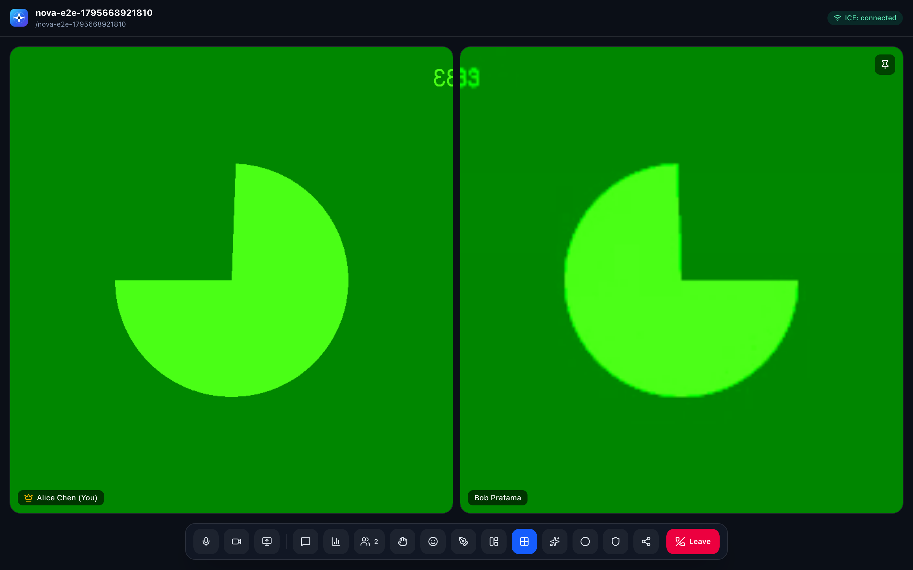
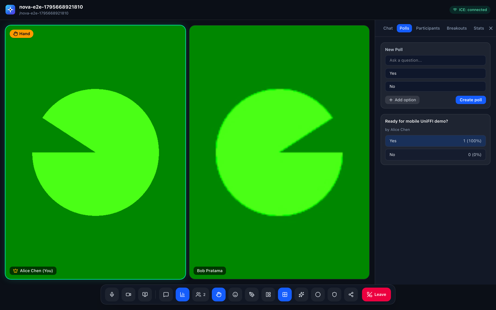
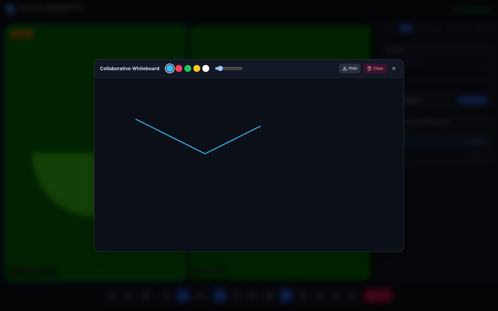

<p align="center">
  <picture>
    <source media="(prefers-color-scheme: dark)" srcset="web/public/brand-assets/logo_dark.svg">
    <source media="(prefers-color-scheme: light)" srcset="web/public/brand-assets/logo.svg">
    
  </picture>
</p>

<h3 align="center">The lightweight video conferencing stack — Rust (Axum + str0m SFU) + React Router PWA + UniFFI Swift/Kotlin rewrite of Jitsi Meet</h3>

<p align="center">
  
  
  
  
</p>

> **Note:** Nova is a ground-up Rust rewrite of [Jitsi Meet](https://github.com/jitsi/jitsi-meet). Prosody (Lua XMPP), Jicofo (Java), Jitsi Videobridge (Java SFU), and Nginx are replaced by one compiled Rust binary (**Axum 0.8** + **str0m 0.26** WebRTC SFU + embedded **SQLite**), paired with a **React Router 8 + Tailwind v4 PWA** (`web/`) and thin native **SwiftUI (iOS)** + **Jetpack Compose (Android)** clients sharing protocol, state, and E2EE key derivation via **Rust UniFFI (`crates/nova-core`)**. Jitsi Meet is © 8x8 / Atlassian / Jitsi contributors, Apache-2.0 licensed (see [`LICENSE-JITSI`](LICENSE-JITSI)). Nova is not affiliated with Jitsi or 8x8.

---

### ⚡ Single binary, ~10–12 MiB RAM locally

No Prosody, no Java JVM (Jicofo/JVB), no Redis, and zero external database process required by default. The HTTP/WebSocket signaling server, multiplexed UDP WebRTC SFU, SQLite persistence, and static React Router PWA run from one compiled executable (**11.44 MiB** release binary + **0.54 MiB** `web/build/client` bundle on macOS `arm64`, starting in **48 ms** at **10.23 MiB** idle / **12.16 MiB** post-load RSS).

### 🎥 Real `str0m` WebRTC SFU & Collaboration

- **Prejoin & Meeting Modes:** Live camera/mic preview, device switching, client-side background blur, Tile / Speaker + Filmstrip / Spotlight Pin layouts, active speaker detection, and local WebM recording.
- **Security & Access Control:** Argon2id (`Algorithm::Argon2id`) host accounts with HMAC-SHA256 `HttpOnly` sessions, Jitsi-compatible HS256 room JWT tokens, room password lock, knock lobby with moderator Admit/Decline, and HKDF + AES-256-GCM E2EE (`nova-core::e2ee` + WebRTC Encoded Transform).
- **Collaboration:** Public chat & private DMs persisted in SQLite, live polls with percentage bars, raise hand, floating emoji reactions, SFU-isolated breakout rooms, collaborative whiteboard with PNG export, speaker talk-time stats, and EN/ID localization.
- **Drop-in Jitsi Compatibility:** Serves `/external_api.js` (`JitsiMeetExternalAPI` / `NovaMeetExternalAPI`), `/config.js`, `/interface_config.js`, and `/embed/{room}` iframe bridge.

### 📱 Native Mobile via Rust UniFFI (Zero React Native / Flutter VM Bloat)

Rather than bundling React Native (`0.85` + Hermes + Metro) or Flutter (Dart VM + Skia), Nova compiles signaling JSON codecs, URL parsing, deterministic `RoomSnapshot` state reduction, and E2EE key derivation once in `crates/nova-core` (`uniffi 0.33`), generating native Swift (`mobile/ios/`) and Kotlin (`mobile/android/`) bindings consumed by thin SwiftUI and Jetpack Compose UIs (Welcome, Recent Meetings, Prejoin, Audio-Only, Car Mode, Tile/Filmstrip Stage, Chat/DM & Polls, Participants/Lobby/Moderation, Breakout Rooms, Security/E2EE, Speaker Stats, Settings).

---

## UI Screenshots

All screenshots below were captured cleanly at `1440×900` (`2×` retina DPR) against the local `--release` `nova serve` binary via headless Chromium (`tools/e2e.mjs`) with **two concurrent WebRTC peers connected through the `str0m` SFU**, zero console errors, zero page errors, and zero failed HTTP requests:

### Welcome & Host Sign In (`/`, `/login`)

| Welcome & Room Launcher | Argon2id Host Sign In |
| --- | --- |
|  |  |

### Prejoin & Multi-Peer `str0m` SFU Video Grid

| Prejoin Device Preview | 2-Peer `str0m` SFU Active Video Grid |
| --- | --- |
|  |  |

### Live Polls / Hand Raise & Collaborative Whiteboard

| Polls, Chat & Hand Raise | Collaborative Whiteboard |
| --- | --- |
|  |  |

---

## Original vs Rewrite Size Comparison

Measured directly on the checked-out upstream [`jitsi/jitsi-meet`](https://github.com/jitsi/jitsi-meet) tree (`../jitsi-meet`) vs `nova` via [`tools/bench.sh`](tools/bench.sh):

| Dimension | Jitsi Meet (`../jitsi-meet`) | Nova Rewrite (`nova`) | Reduction / Delta |
| --- | --- | --- | --- |
| **Source code** | 2,170 files · 272,332 LOC (`.ts`/`.tsx`/`.js`/`.scss`/`.java`/`.swift`/`.kt`, excl. Prosody/Jicofo/JVB repos) | 54 files · 10,132 LOC (`4,572` Rust + `3,554` Web + `2,006` Mobile native UI) | **26.9× fewer LOC** (-96.3%) |
| **Direct frontend npm deps** | 179 npm packages | 12 npm packages (`4` runtime + `8` dev) | **14.9× fewer npm deps** |
| **Runtime processes** | Nginx + Prosody (Lua) + Jicofo (Java) + JVB Videobridge (Java) | **1 binary** (`nova` w/ embedded SQLite + `str0m` SFU) | Single process |
| **Built artifacts** | Multi-container JVM + Lua + Webpack bundles | **`11.44 MiB`** binary + **`548 KiB`** `web/build/client` | Self-contained binary + static PWA |
| **Cold startup to `/health`** | Multi-service JVM/Prosody boot | **`48 ms`** | Instant readiness |
| **Memory RSS (macOS `arm64`)** | Multi-container JVM/Lua footprint | **`10.23 MiB`** idle · **`12.16 MiB`** post-load | Fits in `<15 MiB` |

---

## Benchmark & Shipped-Artifact Audit

Measured with [`tools/bench.sh`](tools/bench.sh) on macOS `arm64` (`oha`, `5 s`, `32` concurrent connections against `target/release/nova serve`):

| Endpoint | Throughput | Average Latency | HTTP 200 Responses (5s) |
| --- | ---: | ---: | ---: |
| `GET /api/status` | **82,833 req/s** | `0.38 ms` | `414,485` |
| `GET /external_api.js` | **145,195 req/s** | `0.22 ms` | `726,376` |

Security hardening and release exposure verified via REA MCP (`docs/REA-AUDIT.md`) on `target/release/nova` (`11,990,832` bytes, `MH_PIE`, stack protector, non-executable stack/heap, code signature present, `exposed: 0`) and `web/build/client` (`exposed: 0`, `22` scanned members).

---

## Layout

```text
crates/
├── nova-core/         Shared signaling protocol, deterministic RoomSnapshot, E2EE HKDF/AES-GCM, UniFFI 0.33 exports
└── nova-server/       Single-binary Axum 0.8 HTTP/WS + str0m 0.26 SFU + SQLite + Argon2id/JWT + /external_api.js
web/                   React Router 8 + React 19 + Tailwind CSS v4 PWA (Bun 1.4.4 -> web/build/client)
mobile/
├── scripts/           generate-bindings.sh (Swift & Kotlin UniFFI codegen)
├── ios/               SwiftPM + SwiftUI native iOS app consuming NovaCore
└── android/           Gradle + Jetpack Compose native Android app consuming uniffi.nova_core
docker/                Multi-stage Bun + Rust Dockerfile & nginx reverse proxy config
tools/                 smoke.sh, 2-peer WebRTC e2e.mjs, bench.sh
scripts/               new-branch.sh, check-branch.sh, check-commit-msg.sh, build-web.sh
.githooks/             commit-msg, pre-commit, pre-push (NVA-NNN/* enforcement)
rust/                  Whole-app port map, ADRs, glossary, research, app-cases, handoff, cutover.sh
docs/                  Architecture, Jitsi compatibility, deploy, git process, REA-AUDIT.md, screenshots/
```

---

## Quick Start

```bash
# 1. Build the React Router 8 PWA (outputs web/build/client)
./scripts/build-web.sh

# 2. Build & run the single-binary Axum + str0m SFU server
cargo build --release --locked -p nova-server
WEB_DIR=web/build/client ./target/release/nova serve
# -> http://127.0.0.1:3000
```

CLI helpers:

```bash
./target/release/nova seed host@nova.local 'StrongPass-2026!' "Alice"
./target/release/nova token standup --moderator --name "Alice"
./target/release/nova hash-password 'StrongPass-2026!'
```

Generate Swift & Kotlin UniFFI bindings and verify the SwiftPM mobile build:

```bash
./mobile/scripts/generate-bindings.sh
(cd mobile/ios && swift build)
```

Docker Compose (`nginx` + `axum` + `10000/udp`):

```bash
cp .env.example .env
docker compose up -d --build
```

## Environment Variables

| Variable | Default | Purpose |
| --- | --- | --- |
| `BIND` | `0.0.0.0:3000` | HTTP + WebSocket listen address |
| `SFU_UDP_BIND` | `0.0.0.0:10000` | Multiplexed `str0m` WebRTC UDP bind address |
| `SFU_PUBLIC_IP` | auto-detected | Public/LAN IPv4 advertised in ICE host candidates |
| `DATABASE_URL` | `sqlite://nova.db?mode=rwc` | Embedded SQLite database path |
| `WEB_DIR` | `web/build/client` | Built React Router static client directory |
| `SECRET_KEY_BASE` | dev key | HMAC secret for `nova_session` cookies (**set in production**) |
| `JWT_APP_ID` / `JWT_APP_SECRET` | `nova-meet` / dev key | HS256 issuer & secret for Jitsi-compatible room JWTs |
| `FRONTEND_URL` | `http://localhost:3000` | Public base URL |
| `STUN_URL` | `stun:stun.l.google.com:19302` | STUN URI exposed in ICE config |

## Branching Model & Tests

Work branches follow `NVA-<number>/<type>-<description>` cut from `develop` (`scripts/new-branch.sh`), with English Conventional Commits enforced by `.githooks/` (`git config core.hooksPath .githooks`). See [`docs/github/`](docs/github/).

```bash
cargo fmt --check
cargo clippy --workspace --all-targets -- -D warnings
cargo test --workspace
(cd web && bun run typecheck && bun run build)
BASE=http://127.0.0.1:3912 ./tools/smoke.sh
BASE=http://127.0.0.1:3912 node tools/e2e.mjs
./tools/bench.sh ../jitsi-meet
```

## License

Apache-2.0 (see [`LICENSE`](LICENSE)). Derived in concept, UX workflows, and `/external_api.js` compatibility from [`jitsi/jitsi-meet`](https://github.com/jitsi/jitsi-meet) (Apache-2.0, see [`LICENSE-JITSI`](LICENSE-JITSI)).
