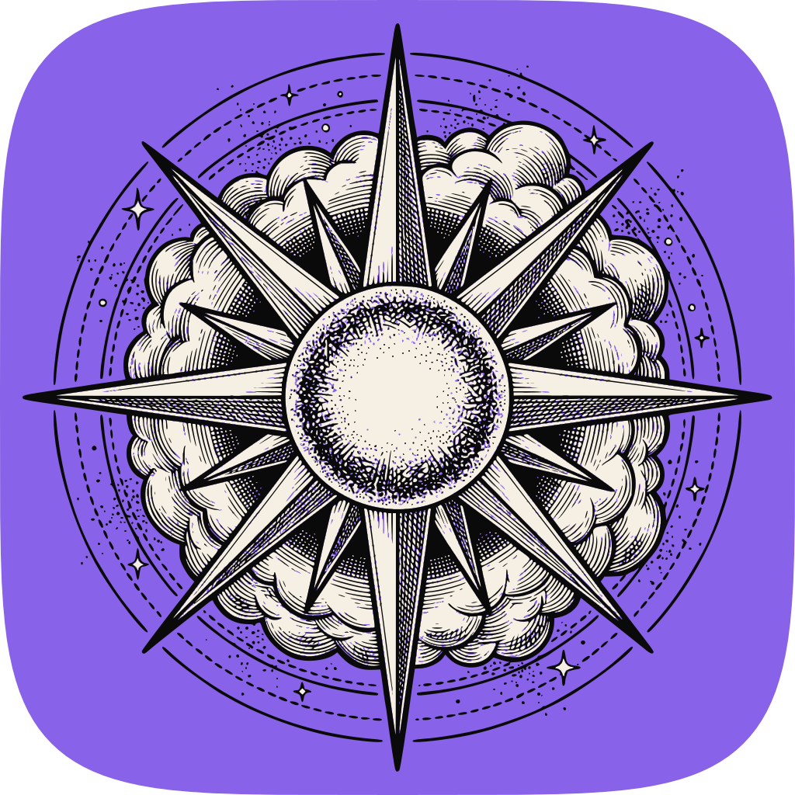
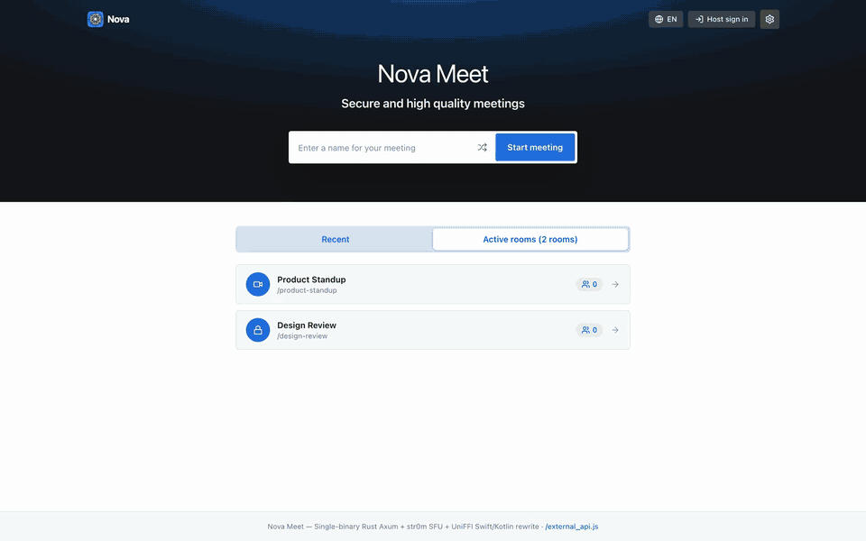
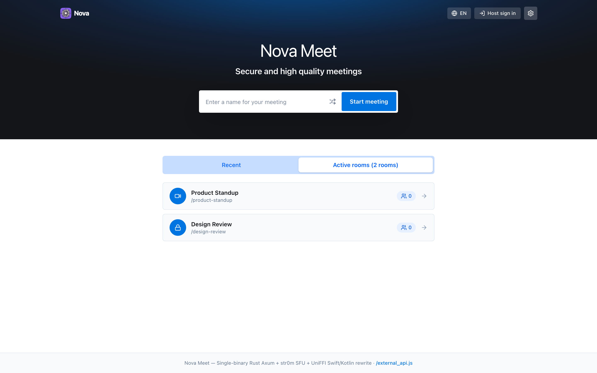
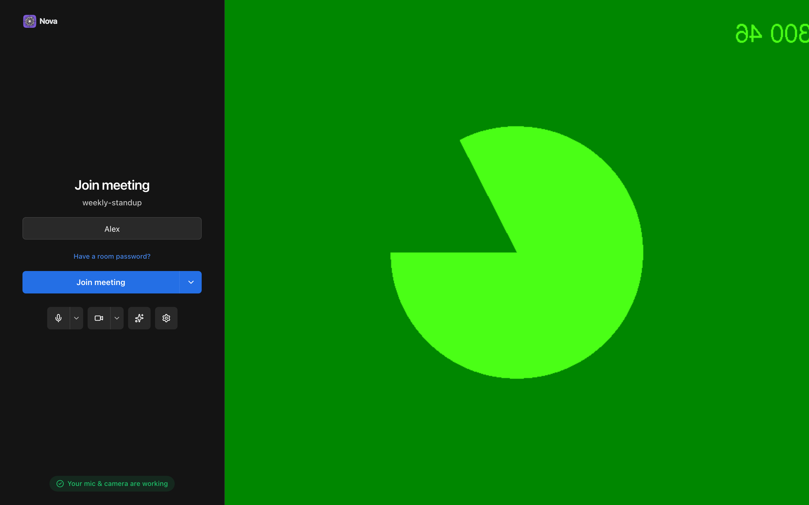
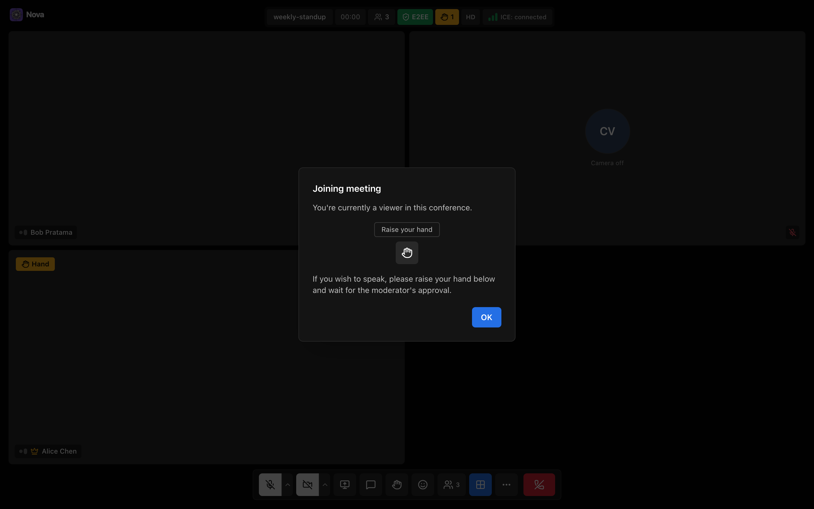
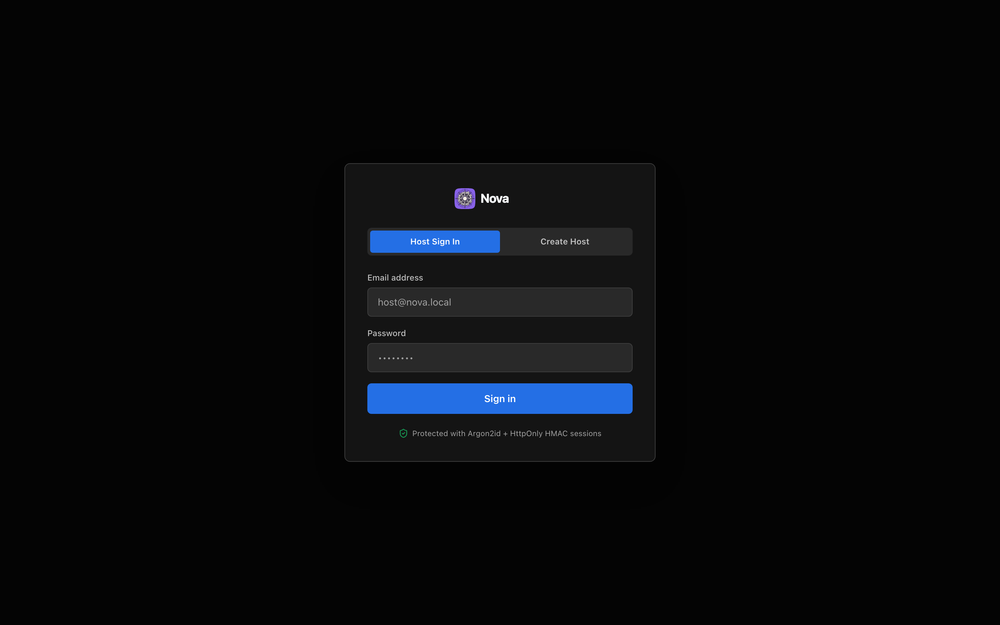
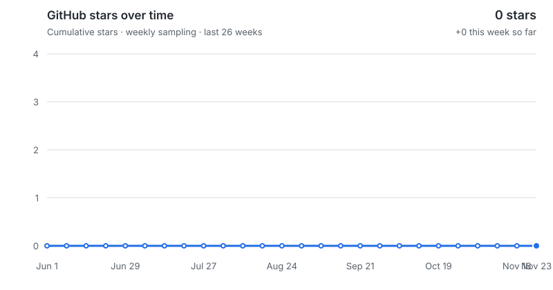

<div align="center">



# Nova

<p>
  <strong>Single-binary Rust WebRTC video conferencing — Jitsi Meet UI &amp; compatibility without JVM or Lua.</strong><br>
  Axum 0.8 + str0m 0.26 SFU + SQLite + React Router 8 PWA + UniFFI Swift/Kotlin. ~11 MiB RAM, zero external runtime.
</p>

[](https://github.com/aphelion31/nova/commits/develop)
[](https://github.com/aphelion31/nova/stargazers)
[](https://github.com/aphelion31/nova/releases)
[](https://github.com/aphelion31/nova/actions/workflows/ci.yml)
[](LICENSE)

</div>

<div align="center">

<a href="docs/media/nova-demo.mp4">
  
</a>

<p><em>Nova walkthrough — Welcome, Prejoin, 2-peer str0m SFU grid, Chat/Polls, Settings, Whiteboard &amp; Visitor dialog (click for MP4)</em></p>

</div>

<div align="center">

## Quick Start

</div>

```bash
# 1. Build the React Router 8 PWA (outputs web/build/client)
./scripts/build-web.sh

# 2. Build & run the single-binary Axum + str0m SFU server
cargo build --release --locked -p nova-server
WEB_DIR=web/build/client ./target/release/nova serve
# -> http://127.0.0.1:3000
```

Or run with Docker Compose (`nginx` + `axum` + `10000/udp`):

```bash
cp .env.example .env
docker compose up -d --build
```

<div align="center">

## Benches

</div>

Measured on macOS `arm64` (`--release`) against the checked-out upstream [`jitsi/jitsi-meet`](https://github.com/jitsi/jitsi-meet) tree (`../jitsi-meet`).

### Codebase, Binary & Memory Footprint

| Dimension | Jitsi Meet (`../jitsi-meet`) | Nova (`nova`) | Comparison |
| --- | --- | --- | --- |
| **Authored source** (excl. server repos) | 2,425 files · 306,507 LOC (`9.58 MiB`) | 62 files · 14,240 LOC (`0.50 MiB`) | **21.5× fewer LOC** (-95.4%) |
| **Clean source tree** | `154.69 MiB` | `2.45 MiB` | **63× smaller** |
| **Direct dependencies** | 179 npm + Prosody + Jicofo + JVB Java | 26 Rust crates + 12 npm | **Single binary (`11.55 MiB`)** + `561.0 KiB` PWA |
| **Runtime processes** | Nginx + Prosody (Lua) + Jicofo (Java) + JVB (Java) | **1 binary** (`nova` + SQLite + `str0m` SFU) | Single process |
| **Cold startup to `/health`** | Multi-service JVM/Prosody boot | **`48 ms`** | Instant readiness |
| **RSS memory** (idle / post-load) | Multi-container JVM/Lua footprint | **`10.67 MiB`** / **`11.91 MiB`** | Fits in `<15 MiB` |

### HTTP Throughput (`oha -z 5s -c 32`)

| Endpoint | Throughput | Average | `p50` | `p95` | `p99` | HTTP 200 |
| --- | ---: | ---: | ---: | ---: | ---: | ---: |
| `GET /api/status` | **94,740 req/s** | `0.34 ms` | `0.27 ms` | `0.71 ms` | `1.53 ms` | `473,997` |
| `GET /external_api.js` | **176,444 req/s** | `0.18 ms` | `0.14 ms` | `0.39 ms` | `0.89 ms` | `882,629` |

[Reproduce](tools/bench.sh) · [Shipped-Artifact Security Audit (REA)](docs/REA-AUDIT.md) (`exposed: 0`, `MH_PIE` enabled, `stack_protector` enabled).

<div align="center">

## Screenshots

2× retina (`1440×900`) captures from live 2-peer `str0m` SFU + E2EE Playwright runs (`tools/e2e.mjs`).

<table>
  <tr>
    <td align="center"><a href="docs/screenshots/home.png"></a><br>Welcome &amp; room launcher</td>
    <td align="center"><a href="docs/screenshots/prejoin.png"></a><br>Split-screen Prejoin</td>
  </tr>
  <tr>
    <td align="center"><a href="docs/screenshots/meeting-grid.png"></a><br>2-peer <code>str0m</code> SFU grid &amp; ConferenceInfo</td>
    <td align="center"><a href="docs/screenshots/meeting-chat-polls.png"></a><br>Chat, Polls, Files &amp; Participants panes</td>
  </tr>
  <tr>
    <td align="center"><a href="docs/screenshots/meeting-settings.png"></a><br>Tabbed Settings dialog</td>
    <td align="center"><a href="docs/screenshots/meeting-whiteboard.png"></a><br>Collaborative Whiteboard</td>
  </tr>
  <tr>
    <td align="center"><a href="docs/screenshots/meeting-visitor-dialog.png"></a><br>Visitor mode &amp; <code>JoinMeetingDialog</code></td>
    <td align="center"><a href="docs/screenshots/login.png"></a><br>Argon2id host sign-in</td>
  </tr>
</table>

</div>

## Jitsi Meet UI & Feature Parity

- **Visual System (`#040404` / `#141414` / `#292929` / `#246FE5`):** Jitsi blue-gradient Welcome screen, split-screen Prejoin (`Join without audio`, `Join audio-only`, device selectors, virtual backgrounds), top `ConferenceInfo` (`MM:SS` timer + live `getStats()` Connection Stats popover), compact floating Toolbox with device chevrons & `...` Overflow Menu, left `Chat / Polls / CC / Files` drawer, right `Participants & Breakout Rooms` pane, bottom-left toast stack, and post-call 5-star feedback persisted in SQLite.
- **Audio, Video & Captions:** Device hot-swapping, WebRTC noise suppression & echo cancellation toggles, mirror toggle, Video Quality presets (`HD` / `SD` / `Low` / `Audio-Only`), Canvas 2D virtual backgrounds (`Slight blur`, `Blur`, `Studio`, `Ocean`, `Warm loft`, `Minimal dark`), Web Speech API Closed Captions + `.txt` transcript export, Talk-While-Muted detection, Fullscreen, Picture-in-Picture, and local WebM recording.
- **Security, Visitors & Moderation:** Argon2id (`Algorithm::Argon2id`) host accounts with HMAC-SHA256 `HttpOnly` sessions, Jitsi-compatible HS256 room JWTs (incl. `visitor` claim), room password lock, knock lobby with quick-Admit toasts, HKDF + AES-256-GCM E2EE (`nova-core::e2ee` + WebRTC Encoded Transform for all peers), Visitor/Viewer mode (`?visitor=true`, PiP-safe `JoinMeetingDialog` backed by central state, `Promote`/`Demote`), AV moderation (`start_audio_muted` / `start_video_muted`), Follow-Me layout sync, `Mute everyone`, and `End meeting for all`.
- **Collaboration & Shared Media:** Chat with replies & DMs, room file sharing (`<= 5 MiB` in SQLite), live polls, synced YouTube/MP4 Shared Video player, raise hand, floating emoji reactions, SFU-isolated breakout rooms, whiteboard w/ PNG export, speaker stats, keyboard shortcuts (`?`, `M`, `V`, `C`, `P`, `R`, `T`, `S`, `W`, `F`, `Space`), and EN/ID localization.
- **Intentional Scope Exclusions ([`ADR-006`](rust/DECISIONS.md)):** Legacy XMPP/BOSH wire protocol (`Prosody`), `Jigasi` SIP/PSTN dial-in, headless Chrome `Jibri` cloud recording/RTMP, and SaaS connectors (Dropbox, Salesforce, Amplitude, Google/Microsoft Calendar OAuth, Etherpad).

## Native Mobile (Rust UniFFI)

Instead of bundling React Native (`0.85` + Hermes) or Flutter (Dart VM), `crates/nova-core` (`uniffi 0.33`) compiles signaling codecs, URL parsing, `RoomSnapshot` state reduction (incl. `ActiveDialog` / `hide_dialog()` / `set_pip_mode()` so Visitor `JoinMeetingDialog` never reappears across PiP transitions), and E2EE key derivation into native Swift (`mobile/ios/`) and Kotlin (`mobile/android/`, `supportsPictureInPicture`) bindings for thin SwiftUI and Jetpack Compose apps (Welcome, Recent Meetings, Prejoin, Audio-Only, Join as Viewer, Car Mode, Tile/Filmstrip, Chat/DM, Polls, Participants/Lobby/Promote, Breakouts, Security/E2EE, Stats, Settings).

```bash
./mobile/scripts/generate-bindings.sh
(cd mobile/ios && swift build)
```

> Android APK packaging requires Gradle / Android SDK and was not built locally.

## Drop-in Jitsi Compatibility

Nova serves `/external_api.js` (`JitsiMeetExternalAPI` / `NovaMeetExternalAPI`), `/config.js`, `/interface_config.js`, and `/embed/{room}` `postMessage` bridge so existing Jitsi iframe embedders work directly without Prosody/JVB.

<details>
<summary>Repository layout, CLI helpers &amp; environment variables</summary>

```text
crates/
├── nova-core/         Shared signaling protocol, deterministic RoomSnapshot, E2EE HKDF/AES-GCM, UniFFI 0.33 exports
└── nova-server/       Single-binary Axum 0.8 HTTP/WS + str0m 0.26 SFU + SQLite + Argon2id/JWT + /external_api.js
web/                   React Router 8 + React 19 + Tailwind CSS v4 PWA (Bun 1.4.4 -> web/build/client)
mobile/                UniFFI bindgen script + SwiftUI (ios/) + Jetpack Compose (android/)
docker/                Multi-stage Bun + Rust Dockerfile & nginx reverse proxy config
tools/                 smoke.sh, 2-peer WebRTC + live E2EE e2e.mjs, bench.sh
scripts/               new-branch.sh, check-branch.sh, check-commit-msg.sh, build-web.sh, build-demo-media.sh
.github/               CI, Lint PR, and weekly star-history chart automation
docs/                  Architecture, Jitsi compat, REA-AUDIT.md, screenshots/, media/, images/
```

CLI helpers:

```bash
./target/release/nova seed host@nova.local 'StrongPass-2026!' "Alice"
./target/release/nova token standup --moderator --name "Alice"
./target/release/nova hash-password 'StrongPass-2026!'
```

| Variable | Default | Purpose |
| --- | --- | --- |
| `BIND` | `0.0.0.0:3000` | HTTP + WebSocket listen address |
| `SFU_UDP_BIND` | `0.0.0.0:10000` | Multiplexed `str0m` WebRTC UDP bind address |
| `SFU_PUBLIC_IP` | auto-detected | Public/LAN IPv4 advertised in ICE host candidates |
| `DATABASE_URL` | `sqlite://nova.db?mode=rwc` | Embedded SQLite database path |
| `WEB_DIR` | `web/build/client` | Built React Router static client directory |
| `SECRET_KEY_BASE` | dev key | HMAC secret for `nova_session` cookies (**set in production**) |
| `JWT_APP_ID` / `JWT_APP_SECRET` | `nova-meet` / dev key | HS256 issuer & secret for Jitsi-compatible room JWTs |
| `FRONTEND_URL` | `http://localhost:3000` | Public base URL |
| `STUN_URL` | `stun:stun.l.google.com:19302` | STUN URI exposed in ICE config |

</details>

<div align="center">

## Star History

<a href="https://github.com/aphelion31/nova/stargazers">
  
</a>

<p><em>Updated automatically by <code>github-actions[bot]</code> via <a href=".github/workflows/update-star-history.yml">update-star-history.yml</a></em></p>

</div>

## Docs & Verification

- Docs map: [`docs/README.md`](docs/README.md) · Architecture: [`docs/ARCHITECTURE.md`](docs/ARCHITECTURE.md) · Jitsi compat: [`docs/architectures/03.JITSI-COMPAT.md`](docs/architectures/03.JITSI-COMPAT.md) · Deploy: [`docs/architectures/04.DEPLOY.md`](docs/architectures/04.DEPLOY.md) · ADRs: [`rust/DECISIONS.md`](rust/DECISIONS.md)

```bash
cargo fmt --check
cargo clippy --workspace --all-targets -- -D warnings
cargo test --workspace
(cd web && bun run typecheck && bun run build)
BASE=http://127.0.0.1:3924 ./tools/smoke.sh
BASE=http://127.0.0.1:3923 node tools/e2e.mjs
./tools/bench.sh ../jitsi-meet
```

## License

Apache-2.0 (see [`LICENSE`](LICENSE)). Derived in concept, UX workflows, and `/external_api.js` compatibility from [`jitsi/jitsi-meet`](https://github.com/jitsi/jitsi-meet) (Apache-2.0, see [`LICENSE-JITSI`](LICENSE-JITSI)). Nova is not affiliated with Jitsi or 8x8.
