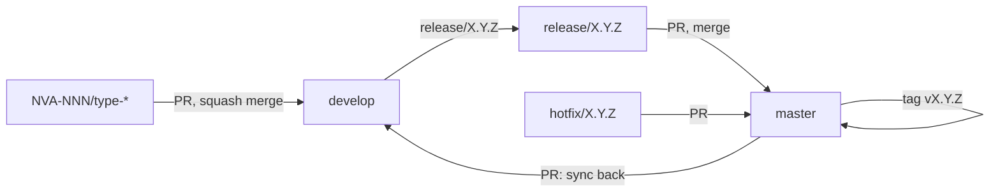

# 03. Pull request flow

How work reaches `develop` and how releases reach `master`. Branch names are in
[02.GIT-BRANCH.md](02.GIT-BRANCH.md), commit format in [01.GIT-COMMIT.md](01.GIT-COMMIT.md).

## 1. Work branch → `develop`

1. Push `NVA-NNN/<type>-<description>` and open a PR into `develop`.
2. **Title:** Conventional Commit (`feat(sfu): add breakout room isolation`). Checked by `Lint PR`.
3. **CI:** `cargo fmt --check`, `cargo clippy --workspace --all-targets -- -D warnings`, `cargo test --workspace`, `(cd web && bun run typecheck && bun run build)`.
4. **Merge with squash** and delete the work branch.

## 2. Release & Hotfix

Versions live in root `Cargo.toml` (`[workspace.package]`) and `web/package.json`. Release branches (`release/X.Y.Z`) merge into `master` with a merge commit, are tagged `vX.Y.Z`, and merge `master` back into `develop`.
